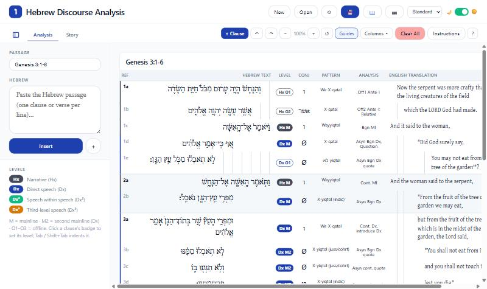

# Hebrew Discourse Analysis

A clause-by-clause worksheet for text-linguistic discourse analysis of Hebrew prose: narrative (Hx) and direct speech (Dx), mainline and offline, with columns for the conjunction, predicate pattern, discourse function and English. A second tab lays out the story's plot as a flow chart.

It runs two ways:

- **In your browser:** https://sots1689.github.io/hebrew-da/ (nothing to install).
- **As an Obsidian plugin:** analyses are saved as `.hda` files in your vault.



## The worksheet

Ref | Hebrew (indented from the right) | Level | Conj | Predicate Pattern | Discourse Analysis | English (indented from the left)

- **Levels:** Hx M/O1–O3, then Dx M/M2/O1–O3, then Dx² and Dx³ for speech inside speech. Click a clause's badge to set its level.
- **Indent** is set separately with Tab / Shift+Tab.
- **Getting text in:** paste Hebrew in the sidebar and click Insert. Verse numbers come from the text, or from the passage reference plus the sof pasuq.
- **Editing:** Enter splits a clause; Backspace at the start joins it to the one above. Ctrl+Z / Ctrl+Y undo and redo.
- **📖** opens the Function of Communication chart at the section for the clause you're working in.
- **Instructions** summarizes the method; **?** explains the tool.
- **📷** exports the current tab as a PNG.
- **Excel import:** converts the older 4-column and the newer 9-column "DA Template" workbooks (`.xlsm`).

## The Story tab

A canvas of plot blocks (verses, title, teaching point, function, characters, location, time, imagery) joined by arrows, which can carry labels. Drag the background or use the mouse wheel to move around, Ctrl+wheel to zoom, and **Fit** to see everything.

## Using the web version

- Your analysis is kept in this browser as you type. It isn't sent anywhere.
- **💾** downloads it as a `.hda` file. **Open** opens a `.hda` file or imports an Excel workbook; you can also drop a file on the page.
- **New** starts an empty analysis. The web version holds one analysis at a time, so download the current one first if you want to keep it.
- `.hda` files move freely between the web version and the Obsidian plugin.
- It works best on a computer or tablet.

## Installing the Obsidian plugin

Once it's listed: Settings → Community plugins → Browse → search "Hebrew Discourse Analysis".

Before then, either:

- install [BRAT](https://github.com/TfTHacker/obsidian42-brat) and add `SotS1689/hebrew-da` as a beta plugin, or
- download `main.js`, `manifest.json` and `styles.css` from the [latest release](https://github.com/SotS1689/hebrew-da/releases/latest) into `<your vault>/.obsidian/plugins/hebrew-da/`, then turn the plugin on in Settings → Community plugins.

Create an analysis with the ו ribbon icon or the command "Hebrew Discourse Analysis: Create new analysis". Use "Import Excel DA workbooks (.xlsm)" to convert old workbooks.

**Settings:** color theme (Standard, Theme, which follows your Obsidian theme, and five color schemes), light/dark mode, UI size, Hebrew font and size, indent width, indent guides.

The plugin works offline and makes no network requests.

## Development

```bash
npm install
npm run build     # plugin: main.js (also copied into the author's test vault)
npm run dev       # plugin, watch mode
npm run web       # web version: docs/ (served by GitHub Pages)
npm run harness   # dev/harness.js: the view on a plain page for checks (open dev/index.html)
```

- `src/model.ts`: data model, levels, verse labels, pattern-to-chart mapping
- `src/HDAView.ts`: the worksheet view; `src/StoryBoard.ts`: the Story tab
- `src/reference.ts`: the Function of Communication chart and instructions
- `src/xlsmImport.ts`: Excel importer
- `web/`: the web version's page and its stand-in for the Obsidian API

Releasing: see [PUBLISHING.md](PUBLISHING.md).

## License

MIT. Uses [html2canvas](https://html2canvas.hertzen.com/) and [JSZip](https://stuk.github.io/jszip/) (both MIT).
